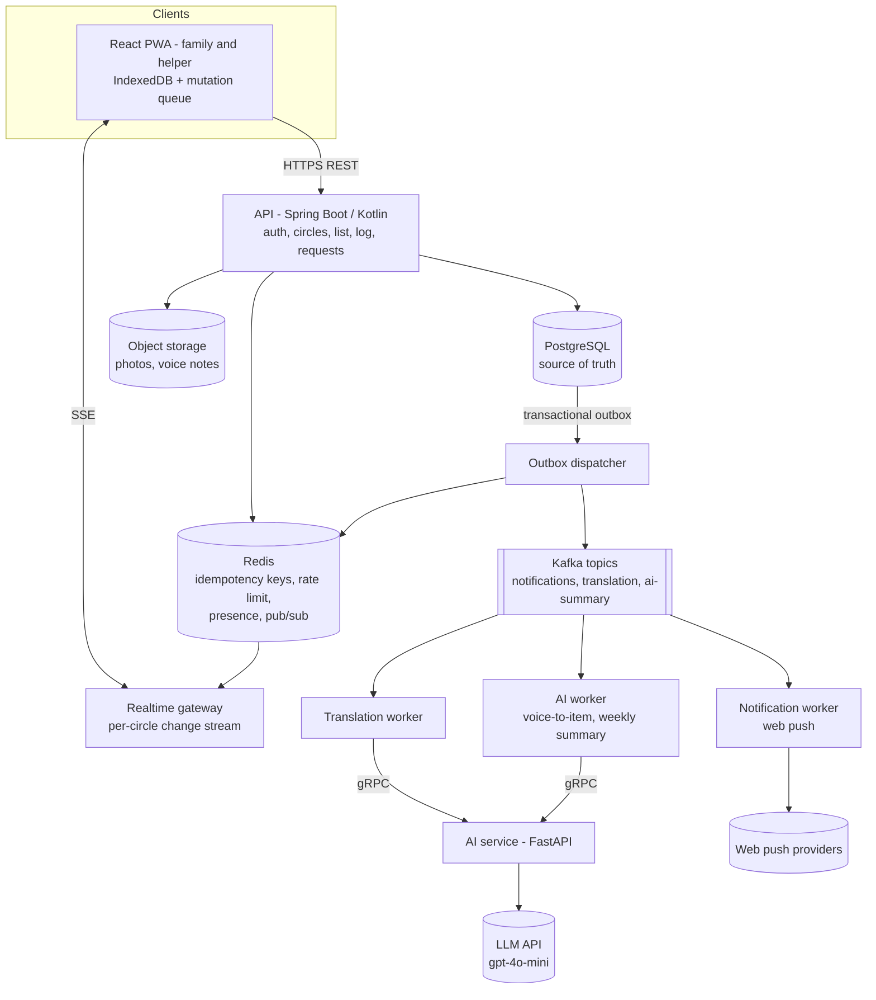
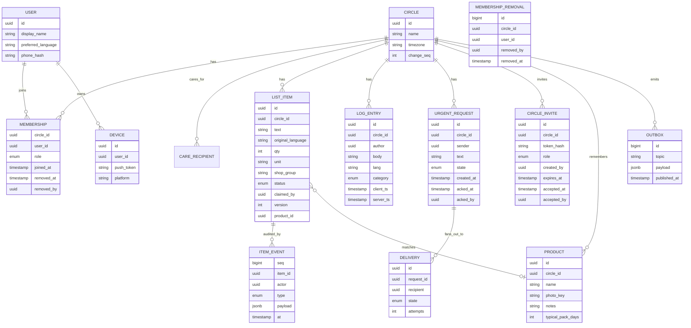
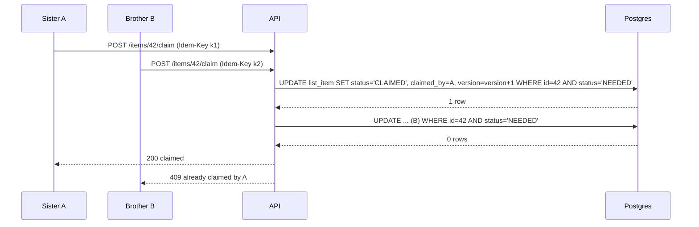
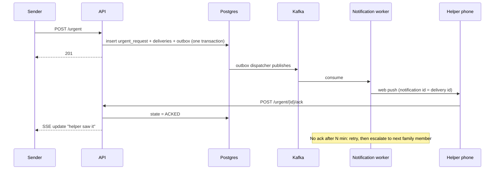
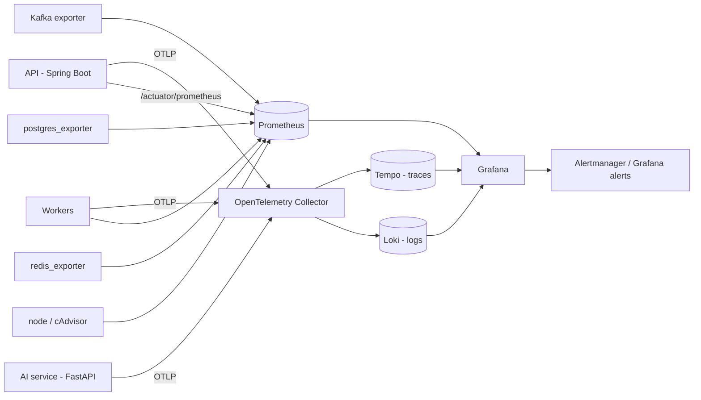

# Care Circle: Architecture Design

Status: Draft, decisions agreed in discussion (see section 12).
Scope: High-level design, data and API design, sync model, and observability.

---

## 1. Problem and Scope

Families in Singapore often share care of an elderly or ill relative between adult children and a live-in domestic helper. Updates, shopping needs and urgent requests (for example, "Dad's medicine needs a top-up") get lost in chat threads and cross a language barrier.

### Functional requirements (MVP)
1. A circle has members with roles: `OWNER`, `FAMILY`, `HELPER`, `VIEWER`.
2. A shared shopping list with quick add by text, voice or photo. Items move through `NEEDED -> CLAIMED -> BOUGHT` or `NOT_FOUND`.
3. An urgent request pushes a notification to the helper and family. The helper acknowledges it.
4. A care log timeline made of append-only entries.
5. Translation of items and requests for the helper, with the original always visible.
6. Offline use for the helper.

### Out of scope for the MVP
Appointments, medication schedules, payments, scheme navigator.

### Non-functional requirements
- Urgent push is delivered at least once and displayed exactly once, with an acknowledgement within seconds.
- No lost writes and no duplicate claims.
- Offline edits sync without silent data loss.
- Private by design: tenant isolation, audit trail, export and delete, no PII in logs.

### Back-of-envelope scale
- Target: 10K circles x 4 users = 40K users.
- About 20 writes per circle per day gives 200K writes/day, roughly 2-3 writes/s average and about 50 writes/s at peak.

The scale is small, so one Postgres instance is enough. The distributed-systems depth comes from correctness (concurrency, idempotency, sync, delivery guarantees), not raw throughput. This should be stated plainly in the README and proven with tests.

---

## 2. High-Level Design

Principle: a modular monolith for the API, plus separate workers for slow and external work (push, translation, AI).

### Protocol choices

| Path | Choice | Reason |
|---|---|---|
| Browser (PWA) to API | REST + SSE | Browsers do not speak native gRPC. gRPC-Web needs a proxy and complicates offline sync debugging and caching. |
| API/workers to AI service (internal) | gRPC | Typed protobuf contract, deadlines, streaming for LLM tokens. |
| Kafka messages | Protobuf with a schema registry | Typed, evolvable event contract. |
| Realtime updates | SSE | Mostly server-to-client traffic, simpler than WebSocket. |

### Notification channel
Web push for the MVP. Define a `NotificationChannel` interface now so SMS or WhatsApp can be added later without rework. iOS supports web push only when the PWA is added to the home screen (iOS 16.4+), so helper onboarding must include "Add to Home Screen" and be tested on a real iPhone.

---

## 3. Datastores

| Store | Holds | Why |
|---|---|---|
| PostgreSQL | All entities, event log, outbox | ACID and row-level concurrency. Source of truth. |
| Redis | Idempotency keys (24h TTL), rate limits and token budgets, presence, pub/sub fan-out, translation cache | Fast and ephemeral. Never the source of truth. |
| Object storage (S3 or MinIO) | Item photos, voice notes, receipts | Keeps large blobs out of Postgres. Signed URLs. |
| Kafka | Notifications, translation and AI jobs | Retries, DLQ, replay, and backpressure toward the LLM and push providers. |
| IndexedDB (client) | Local copy and pending mutations | Required for offline use. |

Trade-off (recorded in an ADR): at about 50 writes/s, Postgres with a job table (`SELECT ... FOR UPDATE SKIP LOCKED`) would also work. Kafka is chosen for retry, DLQ and decoupled consumers around notification and LLM work.

---

## 4. Data Model

Key points:
- IDs are UUIDs generated on the client. This gives idempotency and offline creation.
- `change_seq` is a monotonic per-circle counter incremented in the same transaction as every change. Clients sync with "give me everything after seq N".
- `item_event` is append-only and serves as the audit trail. Current state lives in `list_item`, which is lighter than full event sourcing.
- Translations are stored per `(entity, language)` with a source hash. The original text is never overwritten.
- Every table carries `circle_id`. Postgres row-level security enforces tenant isolation as a backstop.
- Free-text health notes use column-level encryption. Phone numbers are stored hashed for lookup and encrypted at rest.

---

## 5. API Design (REST, JSON)

All mutating calls require an `Idempotency-Key` header. All endpoints are scoped by circle with a role check.

### Auth (phone number + OTP)
- `POST /v1/auth/otp/request`, `POST /v1/auth/otp/verify`
- Long-lived sessions for helpers. OTP requests are rate-limited per number and per IP in Redis, with attempt limits and expiry.
- Invite flow: the owner shares an invite link, which pre-fills the circle on acceptance.

### Circles and members
- `POST /v1/circles`
- `POST /v1/circles/{id}/invites` (`id`, `role`, client-generated high-entropy `token`)
- `POST /v1/invites/{token}/accept`
- `GET /v1/invites/{token}` previews the circle and assigned role before acceptance.
- `GET /v1/circles/{id}/members`
- `DELETE /v1/circles/{id}/members/{userId}` (owner only; soft-removes a member)

Invite links are created by circle owners for `FAMILY`, `HELPER`, or `VIEWER` roles (never `OWNER`). They expire after seven days and can be accepted once. Store only a cryptographic hash of the bearer token; do not log invite tokens. Acceptance and membership creation happen in one database transaction. Repeating acceptance by the same user is safe; another user cannot reuse an accepted invite.

Member roster data exposes display names, roles, and join dates only. Owners can remove non-owner members but cannot remove themselves or another owner. Removal is soft (`removed_at`, `removed_by`) and is also recorded in an append-only `membership_removal` audit table. Removed memberships are excluded from authorization and the active roster; accepting a new invite reactivates the membership while retaining prior removal audit entries.

### Shopping list
- `POST /v1/circles/{id}/items` (`text`, `qty`, `photoId?`, `productId?`)
- `GET /v1/circles/{id}/items?status=&shop=`
- `PATCH /v1/items/{id}` with `If-Match: <version>`
- `POST /v1/items/{id}/claim` returns `200`, or `409` if already claimed
- `POST /v1/items/{id}/status` (`BOUGHT` or `NOT_FOUND`, optional receipt or photo)

### Urgent requests
- `POST /v1/circles/{id}/urgent` (`text`, `itemId?`)
- `POST /v1/urgent/{id}/ack` (`SEEN` or `ON_IT`)
- `GET /v1/urgent/{id}` returns delivery status per recipient

### Care log
- `POST /v1/circles/{id}/log`
- `GET /v1/circles/{id}/log?cursor=&limit=`
- `GET /v1/circles/{id}/summary?week=` (generated asynchronously)

### Sync and realtime
- `POST /v1/circles/{id}/sync/push` sends a batch of queued mutations
- `GET /v1/circles/{id}/sync/pull?since=<seq>` returns the change feed
- `GET /v1/circles/{id}/stream` opens an SSE stream of `change_seq` events

### Media and privacy
- `POST /v1/media/upload-url` returns a signed upload URL
- `GET /v1/me/export`, `DELETE /v1/circles/{id}`

---

## 6. Key Flows

### A. Claiming an item (concurrency)

A conditional `UPDATE` is simpler and safer than a Redis lock because the row is the lock. Redis is used only for idempotency keys, so a retried request returns the original result.
Test to publish: 100 parallel claims produce exactly 1 winner.

### B. Urgent request

- The outbox pattern means a request is never saved without being published, and never published without being saved.
- Delivery is at-least-once. The client dedupes by `delivery_id`, so the user sees it once.
- Failed deliveries go through backoff, then a DLQ. The sender sees "not delivered".

---

## 7. Offline Sync Model

Decision: state machine plus per-field last-writer-wins (LWW). No CRDT in the MVP.

| Data | Conflict type | Strategy |
|---|---|---|
| Care log entries | None (append-only) | Union of entries, ordered by server time |
| Urgent requests | None (create and ack only) | Idempotent create, one-way ack |
| Item status | Real | Server-side state machine. Invalid transitions are rejected and shown to the user. |
| Item fields (qty, note) | Possible | Per-field LWW with server timestamps and a `version` check |
| Long co-edited free text | Real, hard | Not in MVP. This is where CRDT/OT would apply. |

Why not a CRDT everywhere: the data is mostly discrete records and an append-only log. A CRDT adds storage growth, complexity, and a harder permission and audit model.

Example: the helper is offline and marks "paracetamol" as `BOUGHT`. Meanwhile the employer deletes the item. On sync, the `BOUGHT` is not applied and the helper's client shows "this item was removed by Sarah". Conflicts are always visible, never silent.

Implementation: hide the logic behind a `SyncService` interface. If a shared free-text note is added later, only that field gets a CRDT.

Named conflict test scenarios (each with an automated test):
1. Offline delete vs. mark-bought.
2. Two offline edits to the same quantity.
3. Duplicate claim after reconnect.

---

## 8. Translation and AI

- Phase 1 languages: English, Bahasa Indonesia, Filipino/Tagalog. Phase 2: Malay, Mandarin, Tamil, Hindi.
- Translation keyed by `(entity, target_language)` with locale codes (`en`, `id`, `fil`, `ms`, `zh`, `ta`, `hi`). A new language needs only a config entry and an evaluation set.
- Always show the original beside the translation. Medicine names and dosages are protected tokens that are never translated. A product photo is the primary identifier, not text.
- Build a glossary and test set of household and medicine terms per language, reviewed by a native speaker, before claiming translation quality.
- UI strings (i18n files) are separate from machine translation of user content.
- AI only suggests (voice or photo to item, weekly summary). The user confirms.
- Per-circle token budgets live in Redis. Every LLM call is logged with token usage and cost.

---

## 9. Security and Privacy

- Phone number plus OTP login. The OTP provider is mocked in development.
- Phone numbers: hashed for lookup, encrypted at rest. The owner can remove a member, and a helper's identity is not permanently tied to a circle.
- Row-level security on `circle_id`.
- Encryption in transit and at rest, signed media URLs, export and delete endpoints.
- No PII in logs, traces or metrics labels (enforced by a CI test, see section 10.6).
- Designed with PDPA principles. Do not claim "compliant" without a formal assessment. Demo uses synthetic data only.

---

## 10. Observability Architecture

### 10.1 Goals
1. Load analysis: latency, throughput, saturation, queue lag, cost per operation.
2. Log analysis: trace one request from tap to push delivery across API, Kafka and workers.
3. Correctness signals: duplicate claims, lost messages, stuck deliveries, sync conflicts.
4. Demo value: dashboards and load-test numbers in the README.

### 10.2 Stack

| Pillar | Tool | Notes |
|---|---|---|
| Metrics | Micrometer (Spring), `prometheus-client` (Python), scraped by Prometheus | |
| Dashboards and alerts | Grafana (dashboards provisioned from the repo) | |
| Logs | Structured JSON logs to Grafana Loki (via Promtail or Alloy) | Lighter than ELK |
| Traces | OpenTelemetry SDK and collector to Grafana Tempo | Propagated through HTTP, gRPC and Kafka headers |

### 10.3 Metrics

Use RED (Rate, Errors, Duration) for services and USE (Utilization, Saturation, Errors) for resources.

API
- Request rate, error rate, p50/p95/p99 latency per endpoint.
- `claim_total{result="won|conflict"}`, `idempotency_hit_total`.
- Sync batch size, push/pull latency, `sync_conflict_total{type}`.

Pipeline
- Kafka consumer lag per topic and group (main overload signal).
- Processing time, retries, DLQ depth.
- End-to-end urgent latency: `POST /urgent` to push sent, and to helper ack. This is the headline SLI.
- Outbox: unpublished rows and age of the oldest.

Notifications
- Push sent, failed, expired, by platform.
- Deliveries without ack after N minutes (escalation count).

AI and translation
- Calls, latency, tokens, cost per circle.
- Cache hit ratio, rate-limit rejections, translation fallbacks.

Resources
- Postgres: connections, slow queries, locks, cache hit ratio.
- Redis: memory, evictions, ops/s.
- JVM: heap, GC pauses, threads. Host: CPU, memory, disk.

### 10.4 SLOs and alerts

| SLI | Example target |
|---|---|
| Urgent request to push dispatched | 99% under 5 s |
| Claim API success (excluding legitimate 409) | 99.9% |
| Sync pull p95 | under 500 ms |
| DLQ messages older than 1 h | 0 |

Alerts (about five, based on SLO burn rate where possible):
1. Urgent end-to-end latency above target.
2. Kafka consumer lag growing for 5 minutes.
3. DLQ not empty.
4. Oldest outbox row older than 1 minute.
5. API 5xx rate above 2%.

### 10.5 Logs
- JSON, one event per line. Fields: `timestamp`, `level`, `service`, `trace_id`, `span_id`, `circle_id`, `request_id`, `event`, `duration_ms`.
- `trace_id` propagates through HTTP headers, gRPC metadata and Kafka headers, so one Loki query shows a request across every service.
- Levels: `INFO` for business events, `WARN` for retries, `ERROR` only for real failures.
- Short retention (for example, 7 days) in the demo.

Example queries:
- All events for a given `trace_id`.
- Count of `event=claim_conflict` per hour.
- Top error messages in the notification worker.

### 10.6 Privacy rule
Log and trace IDs, never content. No phone numbers, item text, health notes or tokens. Use a span-attribute allow-list and a log scrubber. A CI test fails if sample PII appears in log or trace output.

### 10.7 Tracing mode: on-demand (chosen)

Tracing is controlled by configuration, so the mode can be changed without code changes.

| Mode | Settings | When |
|---|---|---|
| Off / minimal (default) | Sampling ratio 0 on the SDK and collector, or the tracing pipeline disabled | Normal demo operation on a small host |
| Debug / on-demand | Raise the sampling ratio (for example, 1.0) for a short session, then set it back | Showing a trace to someone, investigating a problem |
| Load test | 100% sampling, and note the overhead in results | k6 runs |
| Sampled always-on (future) | About 10% head sampling, tail sampling to keep errors, slow requests and urgent flows, drop health checks and SSE heartbeats, 24-48h retention | When moving to a host with more memory (about 8 GB) |

How to switch:
- SDK side: standard OpenTelemetry environment variables (`OTEL_TRACES_SAMPLER`, `OTEL_TRACES_SAMPLER_ARG`), which typically need a service restart.
- Collector side: the sampling processor in the collector config, which can be reloaded or restarted without touching the services.
- Wrap the switch in a documented script or Compose profile (for example, `docker compose --profile tracing up -d`), so it is a one-command change.

Why on-demand first: the collector and Tempo cost memory on a small host, tracing overhead can distort load-test numbers, traces accumulate storage, and span attributes are a privacy surface. Always keep Grafana behind login.

### 10.8 Load analysis plan
1. k6 scenarios:
   - Steady: 50 writes/s for 10 minutes.
   - Spike: 500 concurrent claims on 50 items.
   - Urgent fan-out: 1,000 circles raise an urgent request in the same minute.
   - Offline reconnect storm: 500 clients push queued mutations at once.
2. Record: p95 latency, error rate, consumer lag, DB CPU and connections, cost per 1,000 operations.
3. Chaos checks: kill a worker mid-batch, stop Kafka for 60 seconds, delay the push provider. Confirm no urgent request is lost and duplicates are not displayed.
4. Publish before/after charts in the README, with at least one concrete finding and fix.

### 10.9 Product analytics vs. system observability
Keep them separate. System metrics go to Prometheus. Product questions (items added per circle, share of helper acks within one minute) come from SQL on Postgres, using no personal content. A few SQL-backed Grafana panels are enough for the MVP.

### 10.10 Rollout phases

| Phase | Add |
|---|---|
| 1 (first service) | JSON logs with `trace_id`, Micrometer metrics, Prometheus, Grafana |
| 2 (when Kafka is added) | Kafka lag and DLQ panels, OpenTelemetry tracing across Kafka, Loki |
| 3 (before load test) | SLO dashboard, alerts, k6 with Grafana annotations |
| Later | Managed services (CloudWatch, Amazon Managed Grafana) if moved to AWS |

---

## 11. Deployment

| Stage | Setup |
|---|---|
| MVP / demo | One EC2 or Lightsail host in `ap-southeast-1` with Docker Compose: API, workers, Postgres, Redis, Kafka (single broker), observability stack. Manual steps in a short `DEPLOY.md`. No Terraform. |
| Later (optional) | Production-like stack on AWS (RDS, ElastiCache, MSK or alternative, S3, ECS Fargate, ALB, CloudWatch, Secrets Manager), described in Terraform and run only for load tests, then torn down. |

Everything runs in Compose first, so moving to AWS is a deploy change, not a redesign. A 4 GB host is tight for this stack. 8 GB is comfortable. Verify memory use on the actual host.

---

## 12. Decision Log

| # | Decision | Status |
|---|---|---|
| 1 | Kafka for async work (ADR documents the Postgres job-table alternative) | Agreed |
| 2 | Web push for MVP, `NotificationChannel` interface for later SMS/WhatsApp | Agreed |
| 3 | REST + SSE at the edge, gRPC internally, protobuf for Kafka events | Agreed |
| 4 | Phone number + OTP authentication | Agreed |
| 5 | Languages: EN, ID, Filipino first; MS, ZH, TA, HI later | Agreed |
| 6 | State machine + per-field LWW, no CRDT in MVP | Agreed |
| 7 | EC2 + Compose for MVP, Terraform deferred | Agreed |
| 8 | Observability: Grafana stack (Prometheus, Loki, Tempo) over ELK | Agreed |
| 9 | OpenTelemetry for traces, logs correlation and Kafka header propagation | Agreed |
| 10 | SLO-based alerts, about five | Agreed |
| 11 | IDs-only logs and traces, CI test for PII leaks | Agreed |
| 12 | Tracing mode: on-demand, switchable by configuration | Agreed |

## 13. Open Items
- Choose an SMS/OTP provider (mock in dev).
- Native-speaker review of the translation glossary for each language.
- Confirm host size once the stack is running.
- Next deliverables: ADR files, OpenAPI spec, protobuf definitions, observability spec.

## 14. Constraint Note
Keep the product clearly household-focused. Do not add business-side booking, client intake or practice-management features, to stay clear of the existing employer NDA. Check the NDA wording if scope changes.
